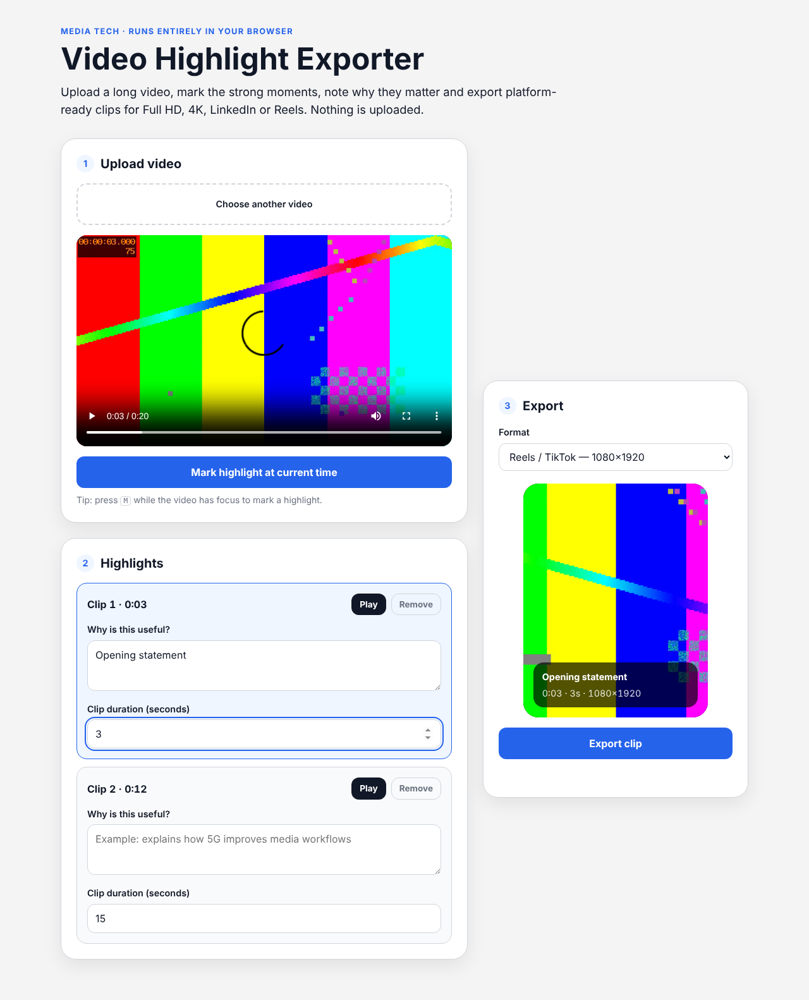

# Video Highlight Exporter

[](https://github.com/xloui99x/tech-video-repurposer/actions/workflows/ci.yml)

Turn a long video (a talk, webinar or interview) into short, platform-ready
clips. Watch, mark the strong moments, note why they matter, and export each
one as Full HD, 4K, LinkedIn square or 9:16 Reels/TikTok. **Everything runs in
the browser**: the video is never uploaded anywhere.

**Live demo:** https://xloui99x.github.io/tech-video-repurposer/



## Why

Repurposing long recordings usually means scrubbing through an hour of
footage, writing down timestamps, then cutting and resizing every clip by hand
in an editor. This tool collapses that into one screen for creators and media
teams: mark while watching, export when done.

## Features

- Mark a highlight with a button or by pressing **M** in the player
- Notes per highlight, shown as a caption in the preview
- Adjustable clip length (3–60 s), automatically shortened at the end of the video
- Highlights stay sorted on a timeline; select, replay or remove them
- Preview in the exact target aspect ratio, so you see the crop before exporting
- Export to H.264/AAC MP4 with live progress

## How it works

```
<video> ──mark──▶ highlightsReducer ──▶ HighlightList / ExportPanel
                         │
                  Export │ buildClipArgs(start, duration, format)
                         ▼
             FFmpeg.wasm (Web Worker, in the browser) ──▶ clip-01-1080x1920.mp4
```

- **FFmpeg compiled to WebAssembly** does the cutting and re-encoding in a Web
  Worker, so the UI stays responsive. The ~30 MB engine is bundled with the
  app (no CDN at runtime) and loaded only on the first export.
- Every format is a fixed frame: the video is **scaled to cover and
  center-cropped** (`scale=…:force_original_aspect_ratio=increase,crop=…`),
  so a 16:9 recording becomes a clean 9:16 clip without black bars.
- The single-threaded core needs no cross-origin isolation, which is why it
  runs on plain static hosting such as GitHub Pages.

### Code structure

```
src/
├── domain/         pure TypeScript, no React, fully unit-tested
│   ├── highlights.ts      state transitions (reducer) and invariants
│   ├── ffmpegCommand.ts   builds the FFmpeg arguments and file names
│   ├── formats.ts         export formats
│   └── time.ts            time formatting
├── hooks/
│   ├── useClipExporter.ts lazy FFmpeg loading, progress, cleanup
│   └── useVideoSource.ts  selected file and its object URL lifecycle
├── components/     SourceVideo, HighlightList, ExportPanel
└── App.tsx         wires state, hooks and components together
```

Design decisions:

- **Business logic outside React.** The reducer and the FFmpeg command builder
  are plain functions, which makes them easy to test and to reason about.
- **Explicit status type.** Export progress is a discriminated union
  (`idle | loading-engine | rendering | done | error`) instead of loose strings,
  so the UI cannot show an impossible state.
- **Memory hygiene.** Videos can be hundreds of megabytes: object URLs are
  revoked when replaced, and FFmpeg's in-memory files are deleted after
  each export.
- **Accessible by default.** Real buttons and labels, `aria-pressed` for the
  selected clip, a live region for export progress, visible focus, dark mode
  and reduced-motion support.

## Development

Requires Node.js 22.22 or later.

```bash
npm install
npm run dev        # http://localhost:5173
npm test           # unit and component tests (Vitest, Testing Library)
npm run lint       # ESLint with strict type-aware rules
npm run build      # type check and production build
```

CI runs formatting, lint, tests and the build on every push; pushes to `main`
deploy to GitHub Pages.

## Limitations

- Encoding runs on one CPU thread in WebAssembly: a 15-second 1080×1920 clip
  takes noticeably longer than a native editor. Short clips and the
  `ultrafast` preset keep it practical.
- Very large source files are limited by the browser's memory.

## Stack

React 19 · TypeScript (strict) · Vite · FFmpeg.wasm · Vitest · Testing Library · ESLint · Prettier · GitHub Actions
